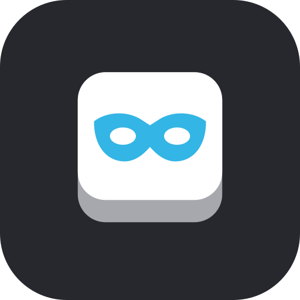
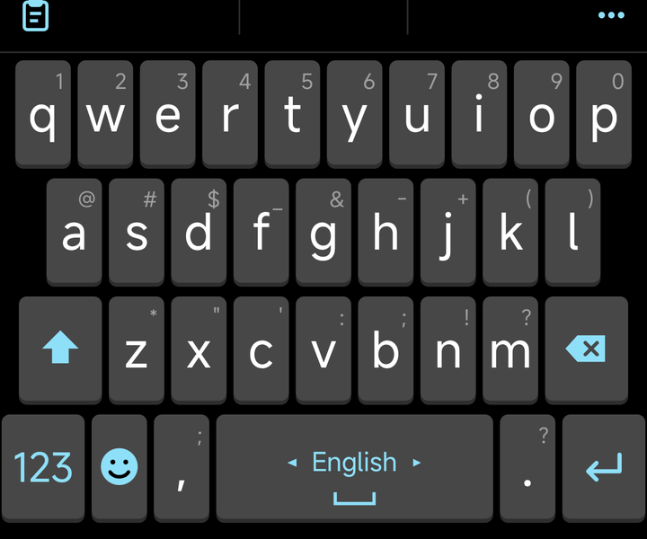
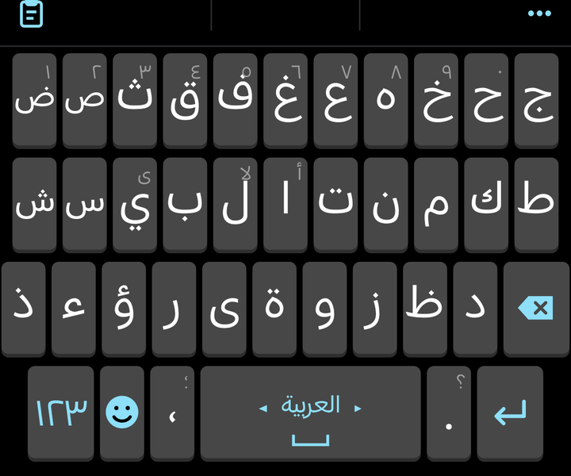

<p align="center"></p>

<h1 align="center">Anon Keyboard</h1>

<p align="center">A small Android keyboard for English and Arabic. No internet permission. Nothing leaves the phone.</p>

<p align="center"> </p>

## Install

1. Download `anon-keyboard-1.0.2.apk` from [Releases](https://github.com/altyb/anon-keyboard/releases/latest). One file for every Android phone, Android 8.0 or newer.
2. Open it and allow installing from your browser or file manager if Android asks.
3. Open **Anon Keyboard**, tap **Enable keyboard**, switch it on, then **Choose keyboard**.

Check the file before installing if you like: the SHA-256 is listed on the release page.

## Why I made it

For years I typed on Ginger Keyboard. Not for the grammar tools. I kept it because of the layout: big keys, the old Android look, numbers and symbols printed on the keys so a long-press gives you what you see. Every newer keyboard I tried felt cramped, or slow after a few weeks, or wanted an account, or showed me things I did not ask for.

What I actually use a keyboard for is simple. I type in Arabic and English all day, I copy and paste a lot, and the thing I look at most is the row of suggestions above the keys. If those suggestions are good, everything else matters less.

So I wrote my own. The rules were: it has to stay light on any Android phone, not only mine. Every feature gets an on/off switch. No internet permission at all, so it cannot send anything even by mistake. And the code has to stay small enough that one person can read all of it.

## What it does

- **Suggestions that predict.** It completes the word you are typing and guesses the next one after a space, using word frequencies and word pairs. It learns your own words over time, on the phone only.
- **Autocorrect that stays out of the way.** It only fixes a word when it is fairly sure, and backspace right after puts your word back.
- **English and Arabic.** Standard Arabic layout with all letters, hamza forms on long-press, and Arabic matching that ignores diacritics. Swipe the space bar to switch.
- **The classic layout.** Tall keys, symbols and digits on the keys, long-press popups with accents.
- **Clipboard.** Recent copies, pin the ones you want to keep, and a paste chip in the suggestion row for what you just copied.
- **Emoji panel** with recents.
- **Two looks.** Classic (the default, above) or Material You: rounder keys in your wallpaper colours with a springy press. Key sizes and layout are the same in both.
- **Calm motion.** Short fades and slides with one shared timing, never on the key press itself. Off with one switch, and off automatically when Android's "Remove animations" is on.

## Privacy

- No `INTERNET` permission. The build checks this.
- Password fields: no learning, no clipboard, no emoji history, and (on by default) the keyboard is hidden from screenshots and screen recording.
- Anything with digits, `@`, `/` or `:` is never learned (codes, card numbers, emails, links).
- Incognito switch: no learning and no clipboard history anywhere.
- Clipboard history is wiped when the screen locks (you can turn that off). Only pinned clips are saved to storage.
- Learned words stay in the app's private storage. Cloud backup and device transfer are off.
- Buttons to clear learned words and clipboard history.

## How it stays fast

The dictionary is built once into a binary trie and memory-mapped, so it is not loaded into RAM. Suggestions are computed on a worker thread and old requests are dropped while you type. The keys are drawn on a single canvas with no allocations while drawing. Learned data has hard size limits and slowly forgets words you stopped using, so it does not grow forever.

Kotlin only. The keyboard itself has no dependencies; the settings screen uses Jetpack Compose with Material 3.

Measured on a Xiaomi 17 Ultra while typing: 0.3% janky frames, median frame 5 ms. The dictionary file carries a checksum; a damaged one is rebuilt instead of crashing the keyboard.

## Build

```
./gradlew assembleDebug
./gradlew testDebugUnitTest
```

Needs JDK 17+ and the Android SDK (compileSdk 36, minSdk 26).

## Credits

Word frequency lists from [hermitdave/FrequencyWords](https://github.com/hermitdave/FrequencyWords) (built from OpenSubtitles), licensed CC BY-SA 4.0. Next-word pairs counted from [Tatoeba](https://tatoeba.org) sentences, CC BY 2.0 FR. See [NOTICE](NOTICE).

## License

Apache License 2.0. See [LICENSE](LICENSE).
